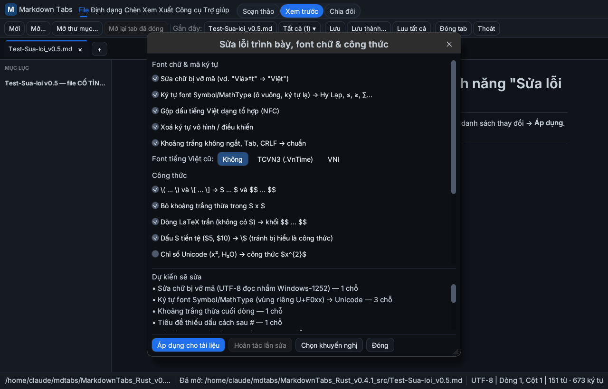

# Markdown Tabs

Trình xem và soạn thảo Markdown nhiều tab, viết bằng Rust (native, không Electron) cho Windows. Giao diện tiếng Việt.

*English: a native Rust Markdown viewer/editor with tabs for Windows. It renders math without internet, fixes broken Vietnamese fonts (TCVN3, VNI) and exports to Word (.docx with editable equations), HTML and PDF. The UI is in Vietnamese.*

## Chức năng chính

- **Nhiều tab, ba chế độ xem:** Soạn thảo, Xem trước, Chia đôi (Ctrl+1, 2, 3). Mở file là vào thẳng Xem trước. Mục lục bên trái, danh sách file gần đây, mở lại tab đã đóng, tự động lưu.
- **Công thức hiển thị thật, không cần mạng:** phân số, căn, chỉ số trên và dưới, tổng, tích phân, giới hạn, ma trận, hệ phương trình, chữ Hy Lạp, vectơ.
- **Sửa lỗi trình bày, font chữ và công thức** (Công cụ, Ctrl+Shift+F): hộp thoại liệt kê thay đổi dự kiến trước khi áp dụng, có hoàn tác.
- **Xuất file:** Word (.docx, công thức thành phương trình Word sửa được), HTML, PDF qua hộp thoại In, văn bản thuần; sao chép HTML hoặc Markdown.
- **Giao diện:** Ribbon theo tab, chế độ Sáng và Tối, bốn màu chủ đạo.

### Sửa lỗi font và công thức

- Chữ vỡ mã (UTF-8 bị đọc nhầm thành Windows-1252), ví dụ `Việt` thành `Việt`.
- Font tiếng Việt cũ **TCVN3 (.VnTime)** và **VNI** sang Unicode.
- Ký tự font Symbol và MathType khi dán từ Word (ô vuông, ký tự lạ) sang chữ Hy Lạp và ký hiệu toán.
- Chuẩn hóa dấu tổ hợp, bỏ ký tự vô hình, khoảng trắng và xuống dòng; thêm dòng phân cách bảng còn thiếu; ký hiệu danh sách và tiêu đề thiếu dấu cách.
- Công thức: `\( ... \)` và `\[ ... \]` sang `$ ... $` và `$$ ... $$`; thoát `\$` cho dấu tiền tệ; kiểm tra công thức sai kèm số dòng.

## Biên dịch trên Windows

Cần Windows 64-bit. Chạy `Bien-dich-Windows.bat`: nếu máy chưa có Rust thì tải trình cài rustup, rồi biên dịch bằng `cargo build --release` và chép `MarkdownTabs.exe` ra thư mục gốc. Mã nguồn nằm trong `src-rust/`. Workflow GitHub Actions `build-windows` cũng biên dịch bản Windows cho mỗi lần đẩy mã.

Cài đặt và gỡ cài đặt cho người dùng hiện tại (không cần quyền quản trị): `Cai-dat-MarkdownTabs-Rust_v0.5.bat` và `Go-cai-dat-MarkdownTabs-Rust_v0.5.bat`.

## Tài liệu

- [Hướng dẫn nhanh](docs/README_HUONG_DAN-RUST_v0.5.md)
- [Ghi chú bản v0.5.0](docs/GHI-CHU-v0.5.0.md): Ribbon, sửa lỗi font và công thức, xuất DOCX, file gần đây.
- [Ghi chú bản v0.6.0](docs/GHI-CHU-v0.6.0.md): giao diện mới, xuất ảnh, bảng và công thức, các giới hạn đã biết.
- [Lịch sử các bản](LICHSU-REV.md)
- Tệp thử trong `mau-thu/`: công thức và xuất file, văn bản lỗi, văn bản dùng font cũ TCVN3 và VNI.

## Giới hạn đã biết

Giao diện v0.6 mới được thử trên một máy Windows 11; chưa thử ở tỷ lệ hiển thị 125% và 150%. Xuất PDF đi qua hộp thoại In của trình duyệt (chọn "Lưu thành PDF"). Chi tiết xem ghi chú v0.6.0.
