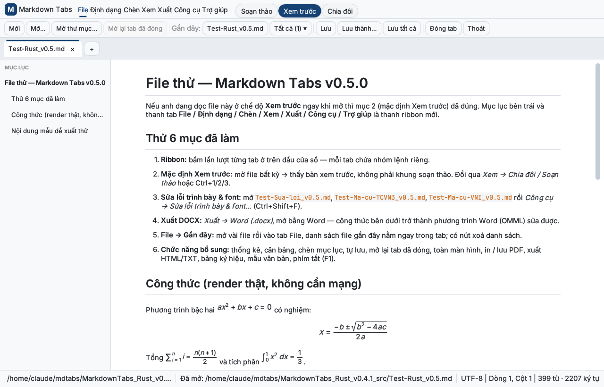
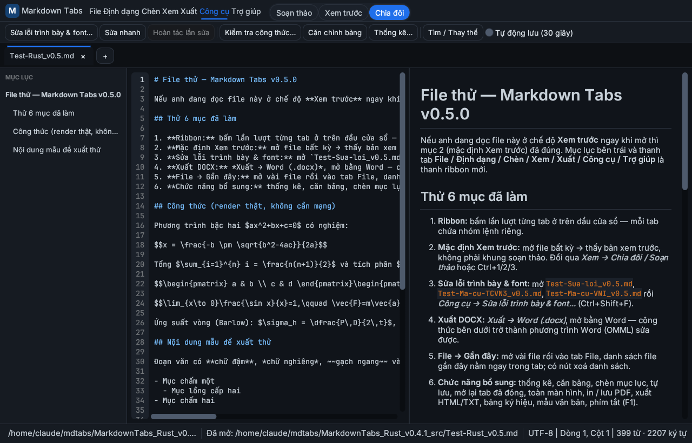

# Markdown Tabs

Trình xem và soạn thảo Markdown nhiều tab, viết bằng Rust (native, không Electron) cho Windows. Giao diện tiếng Việt.

**Tiếng Việt** | [English](#english)

## Chức năng chính

- **Nhiều tab, ba chế độ xem:** Soạn thảo, Xem trước, Chia đôi (Ctrl+1, 2, 3). Mở file là vào thẳng Xem trước. Mục lục bên trái, danh sách file gần đây, mở lại tab đã đóng, tự động lưu.
- **Công thức hiển thị thật, không cần mạng:** phân số, căn, chỉ số trên và dưới, tổng, tích phân, giới hạn, ma trận, hệ phương trình, chữ Hy Lạp, vectơ.
- **Sửa lỗi trình bày, font chữ và công thức** (Công cụ, Ctrl+Shift+F): hộp thoại liệt kê thay đổi dự kiến trước khi áp dụng, có hoàn tác.
- **Xuất file:** Word (.docx, công thức thành phương trình Word sửa được), HTML, PDF qua hộp thoại In, văn bản thuần; sao chép HTML hoặc Markdown.
- **Giao diện:** Ribbon theo tab, chế độ Sáng và Tối, bốn màu chủ đạo.

### Sửa lỗi font và công thức

- Chữ vỡ mã (UTF-8 bị đọc nhầm thành Windows-1252), ví dụ `Việt` thành `Việt`.
- Font tiếng Việt cũ **TCVN3 (.VnTime)** và **VNI** sang Unicode.
- Ký tự font Symbol và MathType khi dán từ Word (ô vuông, ký tự lạ) sang chữ Hy Lạp và ký hiệu toán.
- Chuẩn hóa dấu tổ hợp, bỏ ký tự vô hình, khoảng trắng và xuống dòng; thêm dòng phân cách bảng còn thiếu; ký hiệu danh sách và tiêu đề thiếu dấu cách.
- Công thức: `\( ... \)` và `\[ ... \]` sang `$ ... $` và `$$ ... $$`; thoát `\$` cho dấu tiền tệ; kiểm tra công thức sai kèm số dòng.

## Biên dịch trên Windows

Cần Windows 64-bit. Chạy `Bien-dich-Windows.bat`: nếu máy chưa có Rust thì tải trình cài rustup, rồi biên dịch bằng `cargo build --release` và chép `MarkdownTabs.exe` ra thư mục gốc. Mã nguồn nằm trong `src-rust/`. Workflow GitHub Actions `build-windows` cũng biên dịch bản Windows cho mỗi lần đẩy mã.

Cài đặt và gỡ cài đặt cho người dùng hiện tại (không cần quyền quản trị): `Cai-dat-MarkdownTabs-Rust_v0.5.bat` và `Go-cai-dat-MarkdownTabs-Rust_v0.5.bat`.

## Tài liệu

- [Hướng dẫn nhanh](docs/README_HUONG_DAN-RUST_v0.5.md)
- [Ghi chú bản v0.5.0](docs/GHI-CHU-v0.5.0.md): Ribbon, sửa lỗi font và công thức, xuất DOCX, file gần đây.
- [Ghi chú bản v0.6.0](docs/GHI-CHU-v0.6.0.md): giao diện mới, xuất ảnh, bảng và công thức, các giới hạn đã biết.
- [Lịch sử các bản](LICHSU-REV.md)
- Tệp thử trong `mau-thu/`: công thức và xuất file, văn bản lỗi, văn bản dùng font cũ TCVN3 và VNI.

## Giới hạn đã biết

Giao diện v0.6 mới được thử trên một máy Windows 11; chưa thử ở tỷ lệ hiển thị 125% và 150%. Xuất PDF đi qua hộp thoại In của trình duyệt (chọn "Lưu thành PDF"). Chi tiết xem ghi chú v0.6.0.

## Giấy phép

[MIT](LICENSE).

---

## English

**Markdown Tabs** is a multi-tab Markdown viewer and editor written in Rust (native, no Electron) for Windows. The interface is in Vietnamese.

### Features

- **Multiple tabs and three view modes:** Edit, Preview and Split (Ctrl+1, 2, 3). Opening a file goes straight to Preview. Table of contents on the left, recent files, reopen closed tabs, auto-save.
- **Math rendered offline:** fractions, roots, sub and superscripts, sums, integrals, limits, matrices, cases, Greek letters, vectors.
- **Fix layout, fonts and formulas** (Tools menu, Ctrl+Shift+F): a dialog lists the planned changes before applying them, with undo.
- **Export:** Word (.docx, with formulas converted to editable Word equations), HTML, PDF through the print dialog, plain text; copy as HTML or Markdown.
- **Interface:** tabbed ribbon, light and dark modes, four accent colors.

### Font and formula fixes

- Mojibake (UTF-8 read as Windows-1252), for example `Việt` to `Việt`.
- Legacy Vietnamese fonts **TCVN3 (.VnTime)** and **VNI** to Unicode.
- Symbol and MathType font characters pasted from Word (boxes, odd characters) to Greek letters and math symbols.
- Normalizes combining marks, removes invisible characters, fixes whitespace and line endings, adds missing table separator rows, list bullets and headings without a space after `#`.
- Formulas: `\( ... \)` and `\[ ... \]` to `$ ... $` and `$$ ... $$`; escapes `\$` for currency; checks formulas and reports errors with line numbers.

### Build on Windows

Requires 64-bit Windows. Run `Bien-dich-Windows.bat`: it downloads the rustup installer if Rust is missing, builds with `cargo build --release` and copies `MarkdownTabs.exe` to the repository root. Source code is in `src-rust/`. A GitHub Actions workflow (`build-windows`) also builds the Windows binary on every push. For a per-user install without administrator rights, use `Cai-dat-MarkdownTabs-Rust_v0.5.bat` (uninstall: `Go-cai-dat-MarkdownTabs-Rust_v0.5.bat`).

### Documentation (Vietnamese)

[Quick guide](docs/README_HUONG_DAN-RUST_v0.5.md), [v0.5.0 notes](docs/GHI-CHU-v0.5.0.md), [v0.6.0 notes](docs/GHI-CHU-v0.6.0.md), [version history](LICHSU-REV.md). Sample files for testing are in `mau-thu/`.

### Known limitations

The v0.6 interface was only tested on one Windows 11 machine, not yet at 125% and 150% display scaling. PDF export goes through the browser print dialog (choose "Save as PDF").

### License

[MIT](LICENSE).
