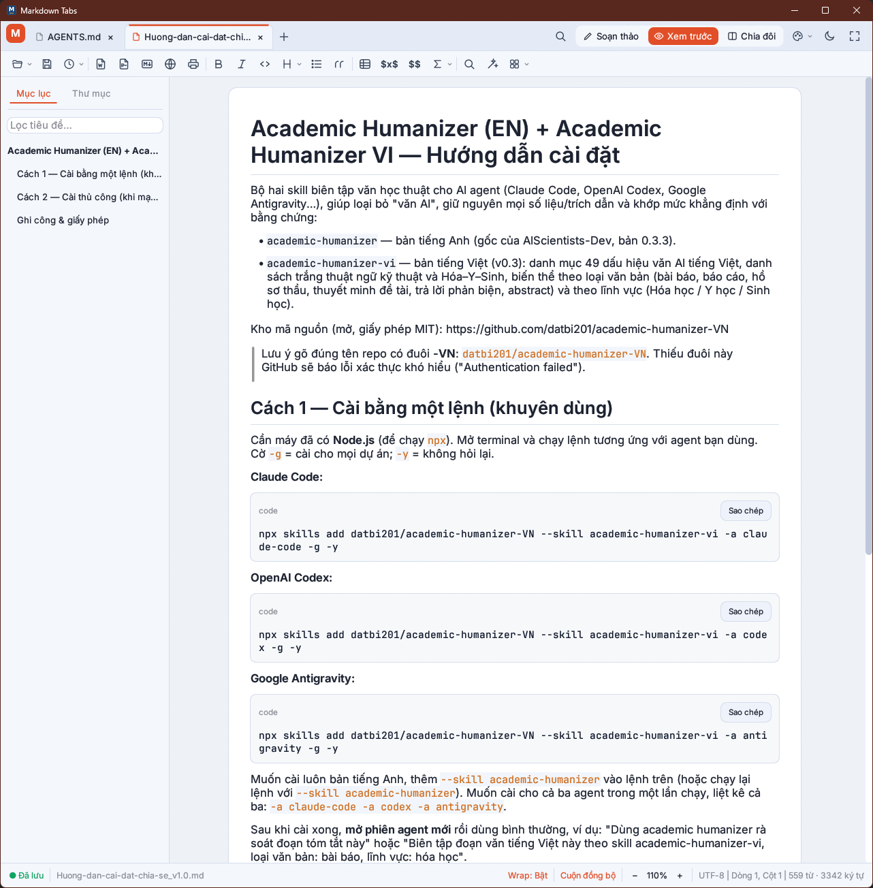
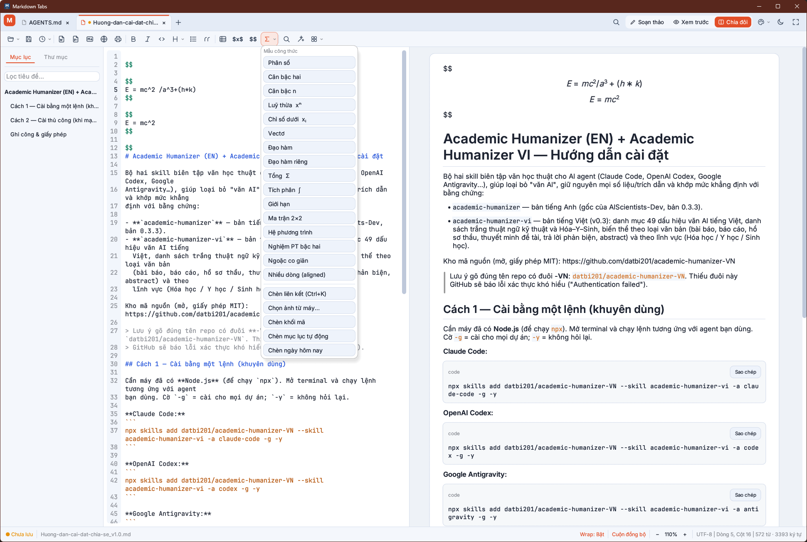
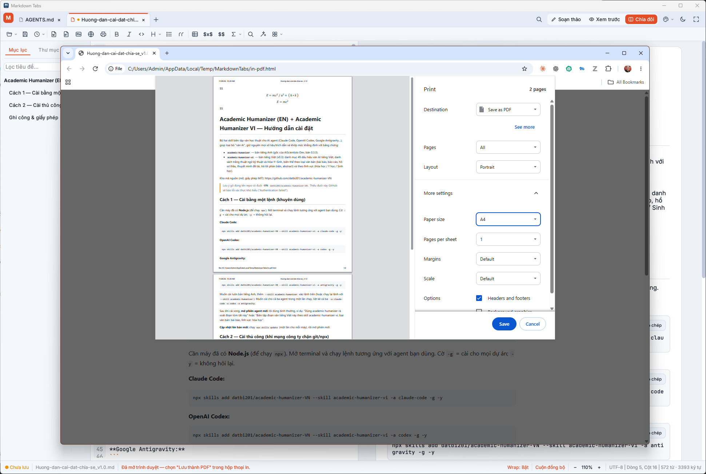

# Markdown Tabs

Trình xem và soạn thảo Markdown nhiều tab **native trên Windows**, viết bằng Rust (`eframe`/`egui`). Ứng dụng được tối ưu cho tài liệu kỹ thuật: hiển thị công thức toán LaTeX hoàn toàn offline, sửa lỗi font tiếng Việt cũ (TCVN3, VNI, Symbol/MathType) và xuất Word (`.docx`) chuẩn phương trình OMML.

> **Phiên bản hiện tại:** `v0.7.3` · **Nền tảng:** Windows 64-bit (`x86_64-pc-windows-msvc`) · **Bản quyền:** MIT

## Tính năng nổi bật

- **Giao diện 2 tầng hiện đại (Sáng & Tối):** Thanh đỉnh hợp nhất Tab tài liệu, chuyển nhanh 3 chế độ xem (**Soạn thảo** / **Xem trước** / **Chia đôi**), đổi **4 màu chủ đạo** (Xanh dương, Lục ngọc, Cam san hô, Tím), nút Sáng/Tối và chế độ **Tập trung (Zen)**.
- **Mặc định Xem trước dạng trang giấy:** Nội dung căn giữa trên nền 4 tầng dịu mắt, hỗ trợ **chú thích ảnh**, **bảng căn lề**, **khối mã có nút Sao chép** và **hệ công thức LaTeX** (phân số, căn, tích phân, ma trận, `cases`, `aligned`…) render trực tiếp không cần Internet.
- **Xuất tài liệu đa định dạng (1 bấm):** Cụm 5 nút **Word (`.docx`)**, **PDF**, **Markdown (`.md`)**, **HTML** độc lập (nhúng sẵn ảnh & MathML) và **In (`Ctrl+P`)** đặt ngay trên thanh công cụ. File `.docx` xuất ra đạt chuẩn OOXML, phương trình chuyển thành **Word Equation (OMML)** chỉnh sửa trực tiếp được trong Microsoft Word.
- **Sửa lỗi trình bày & font tiếng Việt cũ (`Ctrl+Shift+F`):** Tự động khôi phục chữ UTF-8 vỡ mã, chuyển **TCVN3 (`.VnTime`)** và **VNI** sang Unicode chuẩn, đổi ký tự **Symbol/MathType** (`U+F0xx`) về ký hiệu toán học chuẩn, chuẩn hóa dấu công thức `$...$` / `$$...$$`, bảng và danh sách dán từ Word/PDF.
- **Soạn thảo & Điều hướng thông minh:**
  - **Thanh bên 2 tab:** Chuyển nhanh giữa **Mục lục** (có ô lọc tiêu đề) và **Thư mục** (liệt kê tệp đang mở & toàn bộ tệp `.md` cùng thư mục), kéo chỉnh độ rộng linh hoạt.
  - **Cuộn đồng bộ 2 chiều** giữa Soạn thảo và Xem trước ở chế độ Chia đôi, kèm nút bật/tắt **Soft Wrap** (tự xuống dòng mềm) và cụm **Zoom (`−` / `100%` / `+` + `Ctrl+Cuộn chuột`)** ngay trên thanh trạng thái.
  - **Bảng lệnh nhanh (`Ctrl+Shift+P`)** hỗ trợ gõ tiếng Việt không dấu, cùng thanh **Tìm & Thay thế** có bộ đếm kết quả (`x/y`).

## Ảnh chụp giao diện (`v0.7.3`)

*Tham chiếu bản thiết kế tương tác tại [`docs/demo-v0.7.0.html`](docs/demo-v0.7.0.html).*

| Chế độ Xem trước dạng trang giấy | Chế độ Chia đôi & Mẫu công thức | Xuất PDF / In trực tiếp (`Ctrl+P`) |
|---|---|---|
|  |  |  |

## Cài đặt & Sử dụng nhanh

### Cách 1: Dùng bản dựng sẵn (khuyên dùng)
1. Tải gói phát hành `MarkdownTabs-Rust_v0.7.3.zip` (hoặc chạy trực tiếp `MarkdownTabs.exe` trong thư mục `02_LOCAL_RUNTIME`).
2. Giải nén và nhấp đúp **`Cai-dat-MarkdownTabs.bat`** (không cần quyền Administrator, không cần cài Python hay Rust) để gắn liên kết mở mặc định file `.md`.
3. Mở tệp mẫu [`mau-thu/Test-Xuat-file_v0.6.md`](mau-thu/Test-Xuat-file_v0.6.md) để kiểm thử hiển thị hình ảnh, bảng, công thức và xuất `.docx` / `.html` / `.pdf`.

### Cách 2: Tự biên dịch từ mã nguồn
Yêu cầu: **Rust** (toolchain `stable-msvc`) và **Visual Studio Build Tools** trên Windows.

```powershell
cd src-rust
cargo test --release
cargo build --release
```

*(Nếu ổ `C:` gần đầy, đặt biến môi trường `$env:CARGO_TARGET_DIR = "D:\mdtabs-target"` trước khi chạy `cargo`.)*

Tệp thực thi sau khi biên dịch nằm tại `target\release\MarkdownTabs.exe`. Nếu chỉnh sửa bộ biểu tượng trong `tools\gen_icons.py`, chạy lại:

```powershell
python tools/gen_icons.py
```

## Bảng phím tắt

| Phím tắt | Chức năng |
|---|---|
| `Ctrl+N` / `Ctrl+O` | Tạo tài liệu mới / Mở file (chọn được nhiều file) |
| `Ctrl+S` / `Ctrl+Shift+S` | Lưu / Lưu thành… |
| `Ctrl+W` / `Ctrl+Shift+T` | Đóng tab hiện tại / Mở lại tab vừa đóng |
| `Ctrl+1` / `Ctrl+2` / `Ctrl+3` | Chuyển chế độ: Soạn thảo / Xem trước / Chia đôi |
| `Ctrl+Shift+P` | Mở Bảng lệnh nhanh (hỗ trợ gõ không dấu) |
| `Ctrl+F` / `Ctrl+H` | Tìm kiếm / Thay thế (`Enter`: kết quả tiếp, `Esc`: đóng) |
| `Ctrl+Shift+F` | Mở hộp thoại Sửa lỗi trình bày, font chữ & công thức |
| `Ctrl+B` / `Ctrl+I` / `Ctrl+K` | Định dạng **Đậm** / *Nghiêng* / Chèn liên kết |
| `Ctrl++` / `Ctrl+-` / `Ctrl+0` | Phóng to / Thu nhỏ / Đặt lại 100% (hỗ trợ `Ctrl + Cuộn chuột`) |
| `Ctrl+P` / `F11` / `F1` | In hoặc Lưu PDF / Toàn màn hình / Bảng phím tắt |

## Cấu trúc kho mã nguồn

```text
01_REPO_GITHUB/
├── src-rust/              # Mã nguồn Rust (main.rs, features.rs, math.rs, docx.rs, fixer.rs, icons.rs...)
├── tools/gen_icons.py     # Công cụ sinh bộ biểu tượng SVG vector -> src-rust/src/icons_data.rs
├── docs/                  # Ghi chú phát hành (GHI-CHU-v0.7.3.md), bản demo & ảnh chụp v0.7.3
├── mau-thu/               # Các tệp Markdown mẫu kiểm thử công thức, bảng, ảnh & font cũ
├── BAN-GIAO.md            # Hiện trạng phát triển & ghi chú môi trường build
└── LICHSU-REV.md          # Lịch sử các phiên bản từ v0.1 đến v0.7.3
```